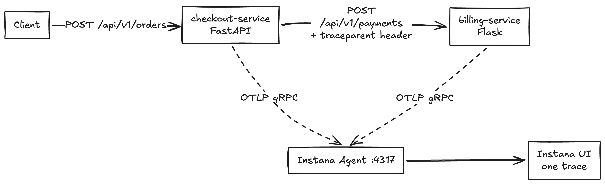
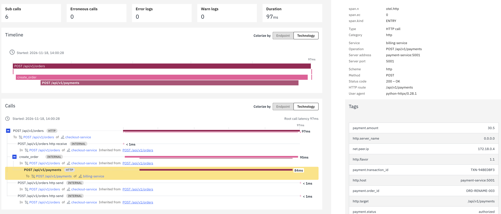

# One Request, Two Services, One Trace: W3C Context Propagation with OpenTelemetry and Instana

*A hands-on walkthrough with two small Python services. No magic, just one HTTP header.*

## The problem: your trace breaks at the first hop

Picture a pizza order. You tap "Order" in the app. The **checkout** service takes it, then asks the **billing** service to charge your card.

Something goes wrong and the pizza never shows up. You open your observability tool and see two *separate* traces: one for checkout, one for billing. Nothing tells you they belong to the same order.

That is a **broken trace**, and it is the first thing that bites you when you move from one service to many.

The fix is surprisingly small, and it is a standard: **W3C Trace Context**. In this post we will build it end to end, using:

- **OpenTelemetry (OTel)** to create the spans,
- **IBM Instana** to collect them and draw the whole trace in one view.

👉 Want to see what the finished result looks like first? Jump to Step 5 at the end. Then come back and build it.

## The big idea: a name tag for your request

How does billing know that the request it just received came from checkout's order?

Think of a **name tag** stuck on every request:

```
traceparent: 00-31ca450f90665942c7de96e7354ccc4e-472db8f825eed919-03
```

Checkout writes the tag. Billing reads it. Both report their work to Instana with the *same* tag. Instana sees the matching ID and puts everything on one timeline.

The header has four parts separated by dashes:

- **`00`** is the version. It is always `00` today.
- **`31ca…4e`** is the trace ID, the "order number" shared by all services.
- **`472d…19`** is the parent span ID, which means "I am the call that triggered you".
- **`03`** holds the trace flags. The lowest bit means "this trace is sampled".

That's all there is to it. If you want the full spec, it's the [W3C Trace Context](https://www.w3.org/TR/trace-context/) page. You don't need it to follow along.

## What we are building



Solid arrows are the real request. Dotted arrows are telemetry: each service sends its spans to the Instana agent, which forwards them to the Instana backend.

What you need: Docker with Compose, and an Instana account (a free trial works) so you can get an agent key.

Here is the project layout we will create, one file at a time:

```
.
├── docker-compose.yml
├── .env
├── agent-config/
│   └── com.instana.agent.main.config.Agent.cfg
├── service_a_order/        # checkout
│   ├── app.py
│   ├── requirements.txt
│   └── Dockerfile
└── service_b_payment/      # billing
    ├── app.py
    ├── requirements.txt
    └── Dockerfile
```

Two small services, one agent, one trace. Let's go.

## Step 1: The checkout service (the one who writes the name tag)

Checkout is a FastAPI app. First we tell OpenTelemetry who we are and where to send spans, then we hook it into FastAPI. Save this as `service_a_order/app.py`:

```python
import os
import httpx
from fastapi import FastAPI
from opentelemetry import trace
from opentelemetry.sdk.trace import TracerProvider
from opentelemetry.sdk.trace.export import BatchSpanProcessor
from opentelemetry.exporter.otlp.proto.grpc.trace_exporter import OTLPSpanExporter
from opentelemetry.sdk.resources import Resource, SERVICE_NAME
from opentelemetry.trace.propagation.tracecontext import TraceContextTextMapPropagator
from opentelemetry.instrumentation.fastapi import FastAPIInstrumentor

provider = TracerProvider(
    resource=Resource.create(
        {SERVICE_NAME: os.getenv("OTEL_SERVICE_NAME", "order-service")}
    )
)
provider.add_span_processor(
    BatchSpanProcessor(
        OTLPSpanExporter(
            endpoint=os.getenv("OTEL_EXPORTER_OTLP_ENDPOINT", "http://instana-agent:4317"),
            insecure=True,
        )
    )
)
trace.set_tracer_provider(provider)
tracer = trace.get_tracer(__name__)

app = FastAPI()
FastAPIInstrumentor.instrument_app(app)   # traces every incoming request

PAYMENT_URL = os.getenv("PAYMENT_SERVICE_URL", "http://payment-service:5001")
```

In plain words: *"My name is whatever `OTEL_SERVICE_NAME` says (we'll set it to `checkout-service`). Send my spans to the Instana agent on port 4317."*

💡 The service name comes from an environment variable, so you can rename a service without touching the code. We will use that later.

Now the important bit, the name tag. Add the order endpoint below the setup. Before calling billing, we copy the current trace context into the outgoing headers:

```python
@app.post("/api/v1/orders")
async def create_order(payload: dict):
    with tracer.start_as_current_span("create_order") as span:
        span.set_attribute("order.id", payload.get("order_id", ""))
        span.set_attribute("order.amount", payload.get("amount", 0.0))

        headers: dict = {}
        TraceContextTextMapPropagator().inject(headers)   # writes `traceparent`

        async with httpx.AsyncClient(timeout=5.0) as client:
            resp = await client.post(
                f"{PAYMENT_URL}/api/v1/payments", json=payload, headers=headers
            )

        # echo the header we sent, so we can compare it later
        return {
            "order_id": payload.get("order_id"),
            "traceparent_sent": headers.get("traceparent"),
            "payment": resp.json(),
        }
```

`inject()` is the one line that matters. It fills `headers` with a ready-made `traceparent`.

🔎 *Curious whether you even need to write this by hand?* Not always. The `opentelemetry-instrumentation-httpx` package can do it automatically. We do it manually here so you can see exactly what happens.

## Step 2: The billing service (the one who reads it)

Billing is a Flask app. Its OTel setup looks the same as checkout's, with a different default name. Save this as `service_b_payment/app.py`:

```python
import os
import time
import uuid
from flask import Flask, request, jsonify
from opentelemetry import trace
from opentelemetry.sdk.trace import TracerProvider
from opentelemetry.sdk.trace.export import BatchSpanProcessor
from opentelemetry.exporter.otlp.proto.grpc.trace_exporter import OTLPSpanExporter
from opentelemetry.sdk.resources import Resource, SERVICE_NAME
from opentelemetry.instrumentation.flask import FlaskInstrumentor

provider = TracerProvider(
    resource=Resource.create(
        {SERVICE_NAME: os.getenv("OTEL_SERVICE_NAME", "payment-service")}
    )
)
provider.add_span_processor(
    BatchSpanProcessor(
        OTLPSpanExporter(
            endpoint=os.getenv("OTEL_EXPORTER_OTLP_ENDPOINT", "http://instana-agent:4317"),
            insecure=True,
        )
    )
)
trace.set_tracer_provider(provider)

app = Flask(__name__)
FlaskInstrumentor().instrument_app(app)   # this line reads `traceparent` for us
```

That last line is the interesting part. There is no code that reads headers.

`FlaskInstrumentor` wraps every incoming request. It looks for `traceparent`, and if it finds one it starts the new span **as a child** of the caller's span. So billing's work automatically lands under checkout's trace.

Now the handler. We add a few attributes to the current span:

```python
@app.route("/api/v1/payments", methods=["POST"])
def process_payment():
    data = request.get_json() or {}
    span = trace.get_current_span()
    span.set_attribute("payment.order_id", data.get("order_id", ""))
    span.set_attribute("payment.amount", data.get("amount", 0.0))
    span.set_attribute("payment.gateway", "MockGateway")

    time.sleep(0.08)  # pretend to talk to a payment gateway

    transaction_id = f"TXN-{uuid.uuid4().hex[:8].upper()}"
    span.set_attribute("payment.transaction_id", transaction_id)
    span.set_attribute("payment.status", "authorized")

    # echo the header we received, so we can compare it later
    return jsonify({
        "status": "authorized",
        "transaction_id": transaction_id,
        "traceparent_received": request.headers.get("traceparent"),
    }), 200
```

Think of attributes as sticky notes on the span. They show up later in the Instana UI.

## Step 3: Dependencies, Docker and the Instana agent

Each service gets a tiny `requirements.txt` and a tiny `Dockerfile`.

For checkout, `service_a_order/requirements.txt`:

```
fastapi>=0.110.0
uvicorn[standard]>=0.28.0
httpx>=0.27.0
opentelemetry-api>=1.24.0
opentelemetry-sdk>=1.24.0
opentelemetry-exporter-otlp-proto-grpc>=1.24.0
opentelemetry-instrumentation-fastapi>=0.45b0
```

And `service_a_order/Dockerfile`:

```dockerfile
FROM python:3.12-slim

WORKDIR /app
COPY requirements.txt .
RUN pip install --no-cache-dir -r requirements.txt

COPY app.py .

EXPOSE 8000
CMD ["uvicorn", "app:app", "--host", "0.0.0.0", "--port", "8000"]
```

For billing, `service_b_payment/requirements.txt`:

```
flask>=3.0.0
gunicorn>=22.0.0
opentelemetry-sdk>=1.24.0
opentelemetry-exporter-otlp-proto-grpc>=1.24.0
opentelemetry-instrumentation-flask>=0.45b0
```

And `service_b_payment/Dockerfile`. It is the same as checkout's, except for the port and the command:

```dockerfile
FROM python:3.12-slim

WORKDIR /app
COPY requirements.txt .
RUN pip install --no-cache-dir -r requirements.txt

COPY app.py .

EXPOSE 5001
CMD ["gunicorn", "-w", "4", "app:app", "-b", "0.0.0.0:5001"]
```

Now `docker-compose.yml` ties everything together. First the two services:

```yaml
services:
  order-service:
    build: ./service_a_order
    ports:
      - "8000:8000"
    environment:
      - OTEL_SERVICE_NAME=checkout-service
      - OTEL_EXPORTER_OTLP_ENDPOINT=http://instana-agent:4317
      - PAYMENT_SERVICE_URL=http://payment-service:5001
    depends_on:
      - payment-service
      - instana-agent

  payment-service:
    build: ./service_b_payment
    ports:
      - "5001:5001"
    environment:
      - OTEL_SERVICE_NAME=billing-service
      - OTEL_EXPORTER_OTLP_ENDPOINT=http://instana-agent:4317
    depends_on:
      - instana-agent
```

The names `order-service` and `payment-service` are just Docker hostnames. The names Instana will show (`checkout-service` and `billing-service`) come from `OTEL_SERVICE_NAME`.

Then, under the same `services:` key, add the agent. It is the official Instana image:

```yaml
  instana-agent:
    image: icr.io/instana/agent:latest-arm64-dynamic   # on Intel/AMD use latest-amd64-dynamic
    volumes:
      - ./agent-config/com.instana.agent.main.config.Agent.cfg:/opt/instana/agent/etc/instana/com.instana.agent.main.config.Agent.cfg:ro
    environment:
      - INSTANA_AGENT_KEY=${INSTANA_AGENT_KEY}
      - INSTANA_DOWNLOAD_KEY=${INSTANA_DOWNLOAD_KEY}
      - INSTANA_AGENT_ENDPOINT=${INSTANA_AGENT_ENDPOINT}
      - INSTANA_AGENT_ENDPOINT_PORT=${INSTANA_AGENT_ENDPOINT_PORT:-443}
    ports:
      - "4317:4317"    # OTLP gRPC
      - "4318:4318"    # OTLP HTTP
      - "42699:42699"  # agent sensor port
```

The agent needs your keys and endpoint from the Instana UI (*Agents & Collectors → Install Agents*). Put them in a `.env` file next to `docker-compose.yml`:

```
INSTANA_AGENT_KEY=<your agent key>
INSTANA_DOWNLOAD_KEY=<your download key>
INSTANA_AGENT_ENDPOINT=<your Instana endpoint>
```

One more small file, `agent-config/com.instana.agent.main.config.Agent.cfg`. The line that matters is `http.listen = 0.0.0.0`. The rest are small tuning settings:

```
# Let other Docker containers reach the agent's ports (OTLP 4317/4318 and sensor 42699).
http.listen = 0.0.0.0
scheduler.threads = 4
http.threads = 4
use-cloud-provider-id = true
mode = APM
```

Then start everything:

```bash
docker compose up --build -d
```

⏳ The agent downloads its feature packages on first start, so give it a minute or two before you send requests.

A few things worth knowing before you hit them yourself:

- **Why `http.listen = 0.0.0.0` matters:** without it, the agent listens on `127.0.0.1` *inside* its own container, and other containers get "connection refused" on `instana-agent:4317`. With it, your services reach the agent by its compose name. (If you cannot use the config file, `host.docker.internal:4317` works as a workaround on Docker Desktop.)
- **Two keys, not one:** the agent key connects the agent to your backend. The download key lets the image pull its feature packages on first start.

## Step 4: Send a request and check the tag

Now the fun part. Send one order:

```bash
curl -s -X POST localhost:8000/api/v1/orders \
  -H 'content-type: application/json' \
  -d '{"order_id":"ORD-001","amount":99.99}'
```

Because both services echo the header, the response shows what checkout sent and what billing received:

```json
{
  "order_id": "ORD-001",
  "traceparent_sent": "00-31ca450f90665942c7de96e7354ccc4e-472db8f825eed919-03",
  "payment": {
    "status": "authorized",
    "traceparent_received": "00-31ca450f90665942c7de96e7354ccc4e-472db8f825eed919-03",
    "transaction_id": "TXN-85653E9E"
  }
}
```

Same trace ID on both sides. The name tag survived the trip.

Want some more traffic for the UI? Run the same `curl` a few times with different `order_id` values.

## Step 5: See it in Instana

Open **Analytics → Applications → Calls**, find a `POST /api/v1/orders` call, and click it.



What you should see, from top to bottom:

```
POST /api/v1/orders              checkout-service   ~97 ms
  └─ create_order                checkout-service   ~95 ms
       └─ POST /api/v1/payments  billing-service    ~84 ms
```

Three things to check:

1. **One trace ID, two services.** `checkout-service` and `billing-service` sit in the same waterfall. No more "two separate traces".
2. **Correct nesting.** The billing call sits *under* `create_order`, exactly where the header was injected.
3. **Your attributes are there.** Click the billing span and look at the tags: `payment.order_id`, `payment.amount`, `payment.transaction_id`, `payment.status` and `payment.gateway`. In the details panel you will also see `span.n = otel.http`, which is how Instana labels spans that arrive via OpenTelemetry.

💡 You may also notice small `INTERNAL` spans such as `http receive` and `http send`. Those come from the FastAPI instrumentation. They are normal and take under 1 ms.

💡 The billing span also shows `payment-service:5001` as its server address. That is just Docker's hostname for the container. The *service name* Instana displays (`billing-service`) comes from `OTEL_SERVICE_NAME`.

### Bonus: rename a service and check again

Remember the environment variable? Change `OTEL_SERVICE_NAME` in `docker-compose.yml`, run `docker compose up -d`, send a request, and the new name shows up in Instana. The trace stays connected, because the *trace ID* ties services together, not their names.

## Takeaways

1. **One header does the work.** `traceparent` carries the trace ID and the parent span ID from service to service.
2. **Write it once, read it automatically.** The caller injects the header, and framework instrumentation (here `FlaskInstrumentor`) reads it for you.
3. **Point everything at the Instana agent.** OTLP on port `4317` (gRPC) or `4318` (HTTP) is all your services need.
4. **Set `service.name` on purpose.** It is how Instana tells your services apart, so keep it meaningful and consistent.
5. **Migrate step by step.** Because the contract is a standard header, any service that speaks W3C Trace Context can join the trace. You can move services over one at a time instead of all at once.

## What's next?

You now have the whole recipe: inject on the way out, extract on the way in, and let Instana stitch the spans together.

Try it with your own services. Add a third hop, a database call, or a message queue, and watch the waterfall grow.

👉 **Full code:** [github.com/CagriYonca/instana-opentelemetry-example](https://github.com/CagriYonca/instana-opentelemetry-example)

*Questions or ideas? Leave a comment, I'd love to hear how you're handling tracing in your own stack.*
